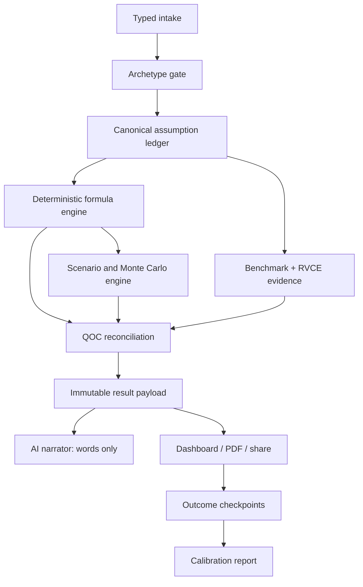

# AIWMC Quantis Accuracy Package v2.0

**Production evidence cut:** 2026-07-21  
**Scope:** deterministic financial engine, benchmark layer, Monte Carlo, RVCE, QOC, AI narrator, dashboard persistence, PDF export, outcomes, and release governance  
**Decision standard:** evidence, reproducibility, and useful uncertainty—not “AI confidence” or marketing language

## 1. Executive decision

Quantis is a real working product with substantial deployed machinery. It is **not yet a validated prediction system**, and no one can honestly guarantee that its forecasts will be commercially successful or match future financial outcomes.

What can be guaranteed after this package is implemented is narrower and valuable:

1. The same valid input, model version, dataset version, and seed produce the same deterministic result.
2. Every displayed number is produced by a registered formula or explicitly labeled external observation.
3. Units, currencies, time bases, revenue archetypes, and unavailable states are typed and enforced.
4. Accounting identities reconcile within an explicit tolerance.
5. Scenario behavior follows declared drivers and invariants.
6. Monte Carlo output is reproducible, correctly labeled, and never represented as empirical accuracy.
7. The narrator cannot create or alter numbers.
8. Dashboard, stored payload, shared report, and PDF contain the same canonical numeric payload.
9. A release cannot ship if golden cases, property tests, artifact parity, calibration, or deployment evidence fail.
10. Forecast performance is measured against later actual outcomes and compared with simple baselines.

The correct positioning is therefore:

> Quantis is a versioned financial pre-mortem and decision-support system that converts explicit assumptions into reproducible scenarios, benchmarks them against declared evidence, and shows where the decision breaks.

Do **not** position it as a guaranteed predictor, a source of “scientifically confirmed” business outcomes, or a system with a defensible accuracy percentage until a prospective outcome study exists.

## 2. Production truth ledger

Evidence labels used below:

- **VERIFIED:** observed in the connected production database, deployed function bundle, current repository, or runtime logs.
- **DOCUMENTED:** described in a handbook but not proven live.
- **INFERRED:** supported by multiple signals but not directly exercised end-to-end in this audit.
- **MISSING:** required proof or implementation is absent.

| Component | Production evidence | Status | Accuracy consequence |
|---|---|---:|---|
| Core analysis | `analyze-business` deployed and active, version 1951 | VERIFIED | A real analysis path exists. Deployment alone does not prove formula validity. |
| Deterministic math | `financial-calculator.ts`, Decimal-backed `QMath`, audit records, CVP/margin/leverage modules | VERIFIED | Strong base, but several legacy formulas and fallbacks remain load-bearing. |
| Typed payback | `MonthsMetricResult` and cumulative-FCF calculator exist | VERIFIED | Correct direction, but it is only a non-fatal cross-check. Legacy `999` remains the returned contract. |
| Magic sentinel | Live calculator still sets `paybackMonths = 999` and downstream code explicitly handles it | VERIFIED—P0 | Customer-facing integrity is not fail-closed. Typed result must replace, not observe, legacy output. |
| Revenue archetypes | Narrow detector warns on contingency, project, and transaction-percentage models | VERIFIED—PARTIAL | High-precision warning helps, but one MRR-shaped core still models unsupported revenue shapes. |
| Benchmark master | Five tables × 19,500 rows = 97,500 modeled cells | VERIFIED | This is a modeled grid, not 97,500 independent real observations. Claims must say “modeled benchmark cells.” |
| Source benchmark table | 39 `industry_benchmarks` rows, all source=`kerry_dataset`; sample size 35–500; average stored confidence 79.18 | VERIFIED | Useful priors, not broad empirical proof. Source lineage and sample-size evidence need audit. |
| Benchmark rendering | Constant sample sizes 230/180/95 and null dataset dates are constructed in code | VERIFIED—P0 | These sample sizes are not tied to the selected row set and must not be displayed as observed N. |
| Benchmark confidence | Recency, sample-size, and source-weight decay function exists | VERIFIED | Formula is interpretable, but base scores/source weights are policy judgments, not calibrated probabilities. |
| Monte Carlo engine | Browser engine uses seeded Mulberry32 and uniform/normal/triangular sampling | VERIFIED | Reproducible when seed is retained. Correlations and time-series dynamics are insufficient. |
| Monte Carlo count | Browser code caps execution at 10,000; tier spec and prompts say 95,500 | VERIFIED—P0 | “95,500 scenarios” is false for this engine path. Either run 95,500 server-side or change all claims/config to 10,000. |
| Monte Carlo corridor | Future months scale current percentiles by a fixed +2% monthly rule when median > 0 | VERIFIED—P1 | This is a display extrapolation, not a simulated time-series distribution. Label or replace it. |
| RVCE function | `rvce-validate` deployed, active, health checks return 200; DeepSeek extraction and DDG/Tavily search code exist | VERIFIED—PARTIAL | Function availability is real; actual evidence coverage is not. |
| RVCE persisted results | 90 analyses; 0 have `rvce_status`; 0 have observation count > 0 | VERIFIED—P0 | RVCE is not proven in the canonical saved analysis path. Do not claim every analysis is live-validated. |
| QOC | `qoc-orchestrate` deployed and health endpoint works | VERIFIED—PARTIAL | Surface exists. |
| QOC envelopes | `qoc_audit_envelopes` has 0 rows | VERIFIED—P0 | QOC is not proven load-bearing for user analyses. |
| Accuracy harness | `run-accuracy-harness` deployed and expects `golden_test_vectors` and `accuracy_runs` | VERIFIED—BROKEN | Both required production relations are absent; the harness cannot complete its documented job. |
| Snapshots | 15 immutable snapshots, engine `2.0.0-precision`, registry `1.0.0` | VERIFIED | Valuable audit mechanism. |
| Snapshot quality | All 15 are `WARN`; every `dataset_version` is null | VERIFIED—P0 | No snapshot is release-grade; reproducibility is incomplete without dataset identity. |
| Outcome loop | `analysis_outcomes` and scheduling schema exist | VERIFIED—PARTIAL | Infrastructure exists. |
| Outcome observations | `analysis_outcomes` has 0 rows | VERIFIED—P0 | No empirical forecast accuracy, calibration, or lift can be computed. |
| Analysis corpus | 90 stored analyses; 26 pass the commercial-clean view | VERIFIED | Evaluation must exclude founder/test fixtures and avoid claiming 90 external cases. |
| Prior PDF corpus | 20-report audit found 86 findings: 70 P0 and 16 P1 | DOCUMENTED WITH REPRO ARTIFACT | Strong defect evidence; rerun against current production outputs before declaring closure. |
| PDF service | `pdf-generator` is active and validates auth, size, cache key, and tier | VERIFIED | Delivery layer exists. Numeric parity must be proven with payload hashes and artifact extraction. |
| Deployment fidelity | Function health/version/commit checks and a deployment workflow exist | VERIFIED | Strong improvement, but migration steps can warn and continue; missing accuracy tables demonstrate remaining drift. |

### Immediate conclusion

The engine is **operational but not accuracy-certified**. Quantis can currently produce useful assumption-driven analyses if it tells users exactly what is user input, modeled prior, live observation, derived calculation, and unknown. It cannot currently substantiate a universal accuracy number or guarantee predicted financial outcomes.

## 3. Why the analysis has value

The value is not “knowing the future.” It is reducing preventable decision error before money is committed.

Quantis is valuable when it does five jobs consistently:

1. **Assumption normalization:** converts a vague idea into explicit revenue, cost, capacity, timing, and financing assumptions.
2. **Financial identity enforcement:** calculates P&L, contribution margin, break-even, cash need, payback, and runway from one canonical ledger.
3. **Stress testing:** reveals which assumptions can break the plan and by how much.
4. **Evidence comparison:** shows how inputs compare with source-qualified reference classes without pretending modeled priors are observations.
5. **Decision packaging:** produces a consultant-ready report where every conclusion links to numbers, sources, limitations, and next validation actions.

The product becomes commercially defensible when a consultant can say:

> “This report did not tell us the future. It found the three assumptions that controlled the decision, showed the funding gap under adverse conditions, and told us what evidence to collect next.”

## 4. What “accuracy” must mean inside Quantis

Never compress accuracy into one percentage. Use an accuracy profile:

| Dimension | Question | Metric / gate |
|---|---|---|
| Computational correctness | Did the code implement the registered formula? | Unit, property, differential, and mutation tests; exact identities |
| Internal consistency | Do all sections use the same canonical values? | Reconciliation gate; zero unexplained contradictions |
| Input fidelity | Did the model use what the user actually supplied? | Field lineage and override audit; zero silent replacements |
| Model applicability | Does the revenue/cost archetype match the business? | Classifier confidence; `MODEL_UNSUPPORTED` / warning policy |
| Evidence quality | Are benchmarks comparable, current, and traceable? | Source grade, observation N, effective N, date, geography, license |
| Uncertainty validity | Do prediction intervals achieve stated coverage? | P80/P90 empirical coverage by archetype and horizon |
| Point forecast error | How far were projections from actuals? | MAE, WAPE, signed bias; MAPE only where denominators are safe |
| Decision usefulness | Did Quantis change or improve the decision? | Decision-change rate, avoided-loss evidence, action completion |
| Artifact integrity | Did dashboard/PDF/share preserve the source payload? | Canonical numeric hash equality |
| Operational reliability | Did every required stage run? | Stage receipt, version, latency, status, error budget |

### The only defensible guarantee

Quantis may guarantee **calculation integrity under a declared model contract**. It must never guarantee profit, market demand, investment return, or future performance.

## 5. Canonical accuracy rails

Every arrow must emit a machine-readable receipt containing correlation ID, stage status, version, input hash, output hash, latency, fallback, and reason code.

### Rail 1 — Typed intake

Each input requires: canonical key, display label, type, unit, currency, period, source class, as-of date, value range, nullability, and user-confirmation status. Never interpret `0`, empty, and unknown as the same thing.

Source classes:

- `USER_ACTUAL`
- `USER_PLAN`
- `DOCUMENT_EXTRACTED`
- `EXTERNAL_OBSERVATION`
- `MODELED_BENCHMARK_PRIOR`
- `DERIVED`
- `DEFAULT_PLACEHOLDER`
- `UNKNOWN`

### Rail 2 — Archetype gate

The model must select or request confirmation of a revenue contract before calculating:

| Archetype | Revenue identity | Required drivers |
|---|---|---|
| Subscription | active accounts × ARPA | opening accounts, adds, churn, expansion, price |
| Unit sales / retail | units × price | units, returns, discounts, channel mix |
| Professional service | billable capacity × utilization × rate | headcount, hours, utilization, rate |
| Project-based | projects × fee recognized by schedule | project count, duration, milestones, backlog |
| Marketplace | GMV × take rate | buyers, sellers, frequency, AOV, take rate |
| Usage-based | billable usage × unit rate | active users, usage distribution, price tiers |
| Contingency / recovery | eligible recovered amount × fee rate × collection probability | cases, recovery size, timing, success, collection |
| Restaurant | seats × turns × occupancy × check × days | capacity, dayparts, mix, waste |
| Rental / occupancy | units × available days × occupancy × ADR | inventory, downtime, occupancy, rate |
| Hybrid | sum of registered revenue streams | one contract per stream; no forced MRR shortcut |

Low-confidence or unsupported classification must return a typed state. It must not quietly run the generic MRR model.

### Rail 3 — Canonical assumption ledger

All engines consume one ledger. No module may independently invent average check, CAC, churn, investment, or fixed costs. Any correction requires a before/after record and user-visible reason. A benchmark outside an allowed range should trigger a warning; it should not automatically overwrite a deliberate user input unless the user chooses “use benchmark.”

### Rail 4 — Formula registry

Every metric requires a registry row with formula ID, semantic definition, valid archetypes, inputs, units, time basis, precision, rounding, invalid states, implementation SHA, tests, and reviewer.

### Rail 5 — Scenario and stochastic engine

- Deterministic base case must use the canonical ledger.
- Scenarios change named drivers, not final outputs.
- Monte Carlo samples drivers and recomputes all dependent metrics per iteration.
- Correlated drivers use a declared correlation matrix with positive-semidefinite validation.
- The seed, iteration count, sampler version, distributions, and bounds are stored.
- P10/P50/P90 are distribution quantiles, not confidence bounds around truth.
- A future corridor must come from per-period simulation, not multiplying one percentile by a fixed growth rate.

### Rail 6 — RVCE evidence

RVCE should validate **inputs and priors**, not “confirm” a forecast. Every accepted observation needs a URL, publisher, publication date, retrieval date, metric definition, value, unit, currency, period, geography, company size/stage, extraction method, quote hash, source-quality score, comparability score, and rejection reason when excluded.

### Rail 7 — QOC

QOC becomes load-bearing only when every commercial analysis stores an envelope and the product blocks or visibly degrades on failed critical gates. A health response is not evidence of orchestration.

Required gates:

- input contract
- archetype applicability
- formula identity
- unit/currency/time-base consistency
- accounting reconciliation
- scenario monotonicity or named counter-driver
- benchmark provenance
- stochastic reproducibility
- narrator numeric firewall
- artifact parity
- version completeness

### Rail 8 — Narrator

The narrator receives an immutable payload and a whitelist of formatted numeric tokens. It may explain, rank, and recommend. It may not calculate, round independently, create targets, invent market sizes, or alter scenario values. Any unapproved number fails generation and falls back to deterministic templates.

### Rail 9 — Dashboard and PDF

Dashboard, stored analysis, PDF, and share page must render from the same canonical report object. Store `canonical_numeric_hash`; extract PDF text in CI and compare every normalized metric. PDF success means both “file generated” and “numbers match.”

### Rail 10 — Outcomes and calibration

Collect actuals at 1, 3, 6, 12, 24, and 36 months, respecting survival and missing-data bias. Compare Quantis against three baselines: user plan unchanged, industry median, and a simple no-growth forecast. Quantis is useful only if it improves decision or forecast metrics relative to those baselines.

## 6. Formula and variable control map

The June handbook’s proposed 60-variable registry is a useful target, but production evidence does not prove all 60 are computed and surfaced under one contract. Ship a smaller certified registry first.

### Certified core candidate

| Metric | Canonical formula | Required inputs | Typed exceptions | Production issue to close |
|---|---|---|---|---|
| Revenue | archetype-specific driver equation | revenue stream drivers | unsupported archetype, missing driver | Core is still predominantly MRR-shaped. |
| COGS | sum of stream-level units × unit variable cost | units, variable cost | missing cost basis | Current fallback often uses benchmark COGS%. |
| Gross profit | revenue − COGS | revenue, COGS | invalid currency/period | Present. |
| Gross margin | gross profit ÷ revenue | gross profit, revenue | not defined when revenue=0 | Do not return misleading 0%. |
| Fixed costs | sum of fixed expense ledger | itemized costs | incomplete ledger | Current user-total reconciliation can force marketing to absorb differences. |
| Acquisition spend | eligible channel spend + sales acquisition labor policy | channel/cohort ledger | policy missing | “Marketing = replacement customers × CAC” is a model assumption, not an identity. |
| Total operating cost | COGS + fixed costs + acquisition spend + other variable costs | canonical ledger | incomplete ledger | Must reconcile across every section. |
| Operating profit | revenue − operating cost | revenue, costs | period mismatch | Present. |
| Net profit | operating profit − interest − tax ± non-operating | full P&L | insufficient inputs | Current value is closer to operating contribution in many cases. Label honestly. |
| Net margin | net profit ÷ revenue | net profit, revenue | revenue=0 | Current integer rounding loses precision. |
| Active customers | opening + adds − churned | cohort schedule | non-customer model | Current fallback `ceil(MRR / revenuePerClient)` may invent customers. |
| Churn | churned opening customers ÷ opening customers | cohort counts | opening=0 | A benchmark prior must not be presented as observed churn. |
| Retention | retained cohort ÷ starting cohort | cohort schedule | no mature cohort | Separate logo and revenue retention. |
| CAC | eligible acquisition spend ÷ new customers | eligible spend, new customers | no acquired customers | Never clamp to a benchmark silently. |
| LTV | expected discounted customer contribution | contribution by cohort, retention curve | immature/unsupported cohort | Current simple margin × frequency × lifetime is an estimate; label formula class. |
| LTV:CAC | LTV ÷ CAC | LTV, CAC | CAC≤0 | Current ratio caps may hide exceptional or bad inputs. Flag rather than rewrite. |
| CAC payback | first fractional cohort month cumulative contribution ≥ eligible CAC | cohort contribution series | not achieved, missing cohort | Production lacks a load-bearing typed CAC-payback contract. |
| Investment payback | first fractional month cumulative FCF + initial outflow ≥ 0 | investment, monthly FCF | not achieved, invalid input | Typed calculator exists but legacy 999 remains returned. |
| Contribution margin | revenue − variable costs | revenue, variable costs | classification missing | Must not floor to 1% when non-positive. |
| Break-even revenue | fixed costs ÷ contribution-margin ratio | fixed costs, CM ratio | `NOT_ACHIEVABLE` when CMR≤0 | Current legacy formula floors CMR to 1%, creating a finite answer. |
| Runway | first month ending cash < 0; or cash ÷ net burn only for stable burn | opening cash, monthly cash flow | no burn, missing cash | Do not reduce volatile businesses to one static ratio. |
| Funding need | absolute minimum cumulative cash deficit including buffer policy | cash-flow schedule | missing financing terms | Needs separate financing flows. |
| ROI | (realized/forecast gain − investment) ÷ investment over named horizon | horizon cash flows | investment≤0 | Current audit note says 12× profit while implementation uses ramped year-one profit. |
| NPV | Σ FCF_t/(1+r_t)^t including t=0 | monthly FCF, discount curve | invalid rate/horizon | Current production uses constant steady-state profit, not the ramped FCF series. |
| Cash conversion cycle | DIO + DSO − DPO | balance-sheet operating data | not applicable | Must not infer for service firms without working-capital inputs. |
| TAM | count of eligible buyers × annual spend, with source chain | scope, buyer count, spend | insufficient evidence | Current fallback uses revenue × 500—must never be treated as researched TAM. |
| SAM | reachable subset of TAM under explicit constraints | geographic/product constraints | missing constraints | Must satisfy SAM≤TAM. |
| SOM | capacity- and acquisition-constrained share of SAM | capacity, conversion, budget | missing capacity | Must satisfy SOM≤SAM. |
| Survival probability | empirical model output for defined cohort/horizon | trained/calibrated dataset | insufficient calibration | Do not infer from generic risk scores. |
| Decision score | transparent weighted decision rubric | dimension scores + evidence quality | incomplete dimensions | Never call this forecast accuracy. |

### Required precision policy

- Money calculations: Decimal, retain at least 4 internal decimal places; round at presentation boundary.
- Rates: store fractions (`0.18`), display percent (`18.0%`); never mix.
- Currency conversion: source, timestamp, and conversion path required.
- Months: typed decimal months for payback; round only display.
- Equality gates: exact Decimal identity where possible; otherwise explicit absolute and relative tolerances.
- Missing, zero, not applicable, and not achieved are separate states.

## 7. Highest-risk production defects and fixes

### P0-1 — Legacy `999` remains load-bearing

**Evidence:** `financial-calculator.ts` sets 999 when payback is not found or profit is negative; typed payback is detection-only and non-fatal.  
**Fix:** make `paybackResult` canonical; derive any legacy display adapter from it; block numeric sentinel serialization across the whole repository, edge functions, and PDF payload.  
**Exit:** zero sentinel hits outside explicit scanner fixtures; 100% artifact tests show typed text.

### P0-2 — Monte Carlo claim/implementation mismatch

**Evidence:** browser code clamps iterations to 10,000 while tier spec, prompts, and copy say 95,500.  
**Fix options:**

1. Preferred: run a versioned server/worker simulation at a justified sample count based on convergence, not marketing symmetry.
2. Immediate: set the product contract to `iterations_actual` and remove every 95,500-scenario claim.

**Exit:** displayed count equals stored actual count; convergence diagnostics and seed retained.

### P0-3 — RVCE not proven in saved analyses

**Evidence:** 0/90 analyses have RVCE status or observations.  
**Fix:** orchestrator stage receipt; normalized observation table; persistence transaction; UI and PDF evidence block; alert if coverage falls below target.  
**Exit:** 20 consecutive staged analyses across five archetypes store ≥1 accepted observation or an explicit `NO_COMPARABLE_EVIDENCE` reason.

### P0-4 — QOC not load-bearing

**Evidence:** 0 QOC audit envelopes.  
**Fix:** route every paid/commercial analysis through QOC or embed gates in the canonical pipeline; store envelope even on short-circuit; prohibit “verified” badge without envelope ID.  
**Exit:** 100% commercial analyses have an envelope and release dashboard shows gate coverage.

### P0-5 — Accuracy harness cannot run

**Evidence:** deployed code queries two missing relations.  
**Fix:** review and stage `quantis_accuracy_migration_proposal.sql`; import candidate corpus; independently promote approved cases; schedule harness; alert on missed runs.  
**Exit:** nightly run row count equals active gold vector count and failures block release.

### P0-6 — Benchmark N and lineage are misleading

**Evidence:** renderer hardcodes 230/180/95 sample sizes and null dates; 97,500 rows are modeled grid cells.  
**Fix:** store `observation_n`, `effective_n`, `modeled_cell_n`, source manifest, transform SHA, date, license, and match distance. Never construct N in presentation code.  
**Exit:** every displayed benchmark row resolves to a release manifest and exact selected evidence set.

### P0-7 — No outcome calibration

**Evidence:** zero outcome rows.  
**Fix:** launch consented outcome program; automate prompts; support business-closed and non-response states; calculate cohort metrics only above minimum N.  
**Exit:** no predictive-accuracy claim until preregistered sample and horizon thresholds are met.

### P0-8 — Generic revenue model applicability

**Evidence:** new warning catches three mismatches but core still funnels diverse models into MRR.  
**Fix:** archetype registry, revenue-stream builder, classifier plus user confirmation, per-archetype formulas and tests.  
**Exit:** unsupported models fail closed; every gold case maps to a registered archetype.

### P1 defects

- ROI audit description disagrees with implementation.
- NPV uses constant steady-state profit rather than modeled monthly FCF.
- Break-even floors non-positive contribution margin to 1%.
- Monte Carlo parameters are independent; business correlations are not enforced.
- Corridor data is an assumed growth transform, not a path simulation.
- Confidence increases with prior analysis count, even though analyses are not outcomes.
- `safe` confidence threshold is policy-based and uncalibrated.
- Some benchmark percentile rows duplicate p50 as p25/p75.
- Narrator fallback contains fixed ROI ranges and generic market language.
- PDF generation proves file delivery but not numeric parity.

## 8. Competitor and category benchmark

There is no exact one-to-one competitor. The closest current product category is a combination of business planning, financial forecasting, idea validation, and scenario analysis.

| Product | Closest capability | What it demonstrates | Quantis differentiation opportunity |
|---|---|---|---|
| LivePlan | Business plan, three-statement forecast, scenarios, market research, plan-vs-actual, accounting integrations, plan review | The strongest direct benchmark for coherent business plan + numbers + actual tracking | Lead with pre-mortem, evidence lineage, assumption sensitivity, and consultant auditability; add real three-statement and plan-vs-actual discipline. |
| IdeaBuddy | Questionnaire-based idea validation plus five revenue models, P&L/cash-flow projection, exports | Revenue archetypes and guided validation are table stakes | Quantis should replace questionnaire scoring with explicit formula/evidence gates and stress tests. |
| Upmetrics | Automated financials, scenario planning, valuation, accounting sync, consultant branding | Ease of use, deliverable quality, and advisor workflows matter | Quantis needs client workspaces, version comparison, white-label evidence packs, and actual-vs-plan feedback. |
| Causal / Lucanet | Connected xP&A and operational/financial planning | Mature users expect traceable models and real-time plan updates | Quantis should avoid competing as a spreadsheet replacement; own early decision validation and pre-mortem. |

Closest overall: **LivePlan**, because it now spans idea testing, research, integrated forecasting, review, export, and actual tracking. Quantis should not try to win by claiming more AI. It should win by making every assumption, evidence item, formula, stress, and limitation auditable.

## 9. Wolfram-like and open computation strategy

Do not send the canonical business model to a general question-answering API and treat the answer as truth. Build three layers:

1. **Local canonical math:** Decimal.js or math.js BigNumber for typed formulas, units, matrices, and deterministic transforms.
2. **Statistical service:** Python/SciPy for distributions, quasi-Monte Carlo, bootstrap intervals, calibration, correlation repair, and statistical tests. Keep a versioned internal API.
3. **External computation/adjudication:** Wolfram APIs only for narrow symbolic checks, equation transformations, unit conversions, or second-opinion calculations. Cache request, response, query version, and interpretation. Never let it silently overwrite canonical output.

Recommended open components:

- Decimal.js: currency and ratio arithmetic already aligned with the codebase.
- math.js: units, matrices, BigNumber, and expression support.
- SciPy/NumPy: stochastic simulation, bootstrap, QMC, optimization, statistical diagnostics.
- statsmodels: regression and time-series models after outcome data exists.
- Hypothesis/fast-check: property-based tests.
- JSON Schema/Zod: runtime contracts.
- OR-Tools: constrained capacity, staffing, allocation, and scheduling recommendations—not basic accounting.
- DuckDB/Polars: reproducible benchmark transformation and quality reports.
- Great Expectations or Pandera: benchmark and outcome data contracts.

Wolfram’s official APIs provide computational knowledge integration and a limited free non-commercial tier; production use needs commercial terms. Math.js supports BigNumber, units, matrices, and symbolic expressions. SciPy provides probability distributions, quasi-Monte Carlo, bootstrap, and statistical tests. OR-Tools is appropriate for optimization problems. These tools improve calculation capability; none makes weak assumptions or unsourced data scientifically valid.

## 10. The 1,000-case program

The delivered CSV contains exactly 1,000 deterministic candidate cases:

- 10 revenue archetypes
- 5 data-quality tiers
- 20 stress/boundary patterns
- 10 rotating locations

Each row contains independent Decimal reference outputs for revenue, variable cost, total cost, contribution, net profit, and break-even, plus invariants and expected gate behavior.

### Honest promotion ladder

| Level | Meaning | Requirement |
|---|---|---|
| Candidate | Generated specification case | Schema-valid; deterministic oracle included |
| Silver | Independently recalculated | Second implementation agrees; invariant suite passes |
| Gold | Release-blocking trusted fixture | Finance reviewer + engine reviewer sign; source evidence attached; expected artifact approved |
| Outcome-backed | Empirically evaluated | Actual outcome at named horizon; no leakage; included in calibration cohort |

Calling all generated rows “gold” immediately would recreate the current benchmark mistake: volume is not evidence. Target progression:

- Week 1: promote 40 boundary/identity cases.
- Week 2: promote 100 cases covering all archetypes and error states.
- Month 1: 250 gold cases.
- Quarter 1: 1,000 gold cases, with at least 20 artifact-level PDFs and 100 differential cases per primary archetype.

## 11. One hundred technical accuracy questions

Each question includes the current answer and the closure requirement.

### Domain A — Claims, scope, and model applicability

1. **What exactly does Quantis predict?** Current: multiple financial and narrative outputs without a single registered prediction target. Close: target registry by metric, horizon, archetype, and loss function.
2. **Which outputs are calculations versus forecasts?** Current: mixed. Close: immutable provenance class on every field.
3. **Which business archetypes are truly supported?** Current: generic core plus narrow mismatch warnings. Close: approved archetype registry and fail-closed unsupported state.
4. **Can hybrid revenue streams be modeled separately?** Current: not proven. Close: stream ledger and aggregation tests.
5. **Does the user confirm the selected archetype?** Current: not proven. Close: explicit confirmation or visible low-confidence warning.
6. **Are project and contingency models prevented from entering MRR logic?** Current: warning only. Close: archetype-specific engine or block.
7. **Is “accuracy” defined without one generic score?** Current: confidence scores risk conflation. Close: published multi-dimensional accuracy profile.
8. **Are profit or outcome guarantees prohibited in every surface?** Current: disclaimer exists; claims historically overstated evidence. Close: claim linter and legal-approved copy registry.
9. **Is model scope shown before results?** Current: warning banner is partial. Close: applicability card with supported/unsupported assumptions.
10. **Is every verdict tied to a decision rule?** Current: partly formula/prompt driven. Close: versioned verdict policy and test vectors.

### Domain B — Input contracts and personalization

11. **Does every numeric input have a unit, currency, and period?** Current: not universally. Close: typed input schema.
12. **Are zero, null, unknown, and not applicable distinct?** Current: historical falsy-value bugs prove risk. Close: discriminated unions and boundary tests.
13. **Are user actuals kept separate from user plans?** Current: not consistently proven. Close: source class per field.
14. **Are document-extracted values traceable to page and text?** Current: parser exists, lineage not audited. Close: extraction coordinates and confirmation.
15. **Can the engine silently replace user input with a benchmark?** Current: yes, range corrections/clamps occur. Close: warn and request consent; never silently overwrite.
16. **Are corrections preserved with before/after/reason?** Current: yes in parts. Close: canonical ledger across all stages and PDF.
17. **Are time bases normalized before arithmetic?** Current: not fully evidenced. Close: period conversion service and tests.
18. **Are currency conversions versioned?** Current: not proven. Close: FX source, timestamp, rate, and base/quote storage.
19. **Does location affect only defensible variables?** Current: static multipliers influence several costs. Close: variable-level evidence and no double adjustment.
20. **Is personalization measurable?** Current: industry/location/subindustry logic exists. Close: ablation test against generic baseline.

### Domain C — Formula correctness

21. **Is there one active formula registry?** Current: snapshot says v1.0, but only partial registry is evidenced. Close: database-backed registry linked to implementation SHA.
22. **Is revenue archetype-specific?** Current: not sufficiently. Close: one formula contract per revenue stream.
23. **Does total cost reconcile to its components?** Current: repairs exist after prior contradictions. Close: exact gate on every output.
24. **Is gross profit exactly revenue minus COGS?** Current: implemented. Close: property and artifact tests.
25. **Is net profit truly after all required items?** Current: often functions as simplified operating profit. Close: rename or implement taxes/interest/non-operating policy.
26. **Is break-even unavailable when contribution margin is non-positive?** Current: no; 1% floor. Close: typed `NOT_ACHIEVABLE`.
27. **Is investment payback cumulative FCF?** Current: typed cross-check yes, canonical legacy no. Close: typed path becomes load-bearing.
28. **Is CAC payback cohort contribution?** Current: not proven. Close: dedicated typed formula and cohort series.
29. **Does NPV use the same monthly cash-flow path as payback?** Current: no; constant steady profit. Close: shared cash-flow schedule.
30. **Does ROI documentation match code?** Current: no. Close: generated formula documentation from registry.

### Domain D — Accounting and cash-flow integrity

31. **Does Quantis produce a coherent P&L, cash flow, and balance sheet?** Current: not proven as a three-statement model. Close: linked statements or narrower claims.
32. **Are depreciation, tax, interest, and financing flows explicit?** Current: not central. Close: policies by archetype/stage.
33. **Is working capital modeled for inventory/receivables/payables?** Current: benchmark columns exist. Close: monthly cash schedule integration.
34. **Does beginning cash plus cash flow equal ending cash?** Current: gate not proven. Close: exact identity.
35. **Are debt draws and repayments separated from operations?** Current: not proven. Close: financing ledger.
36. **Can profit be positive while cash is negative?** Current: reports may not fully show this. Close: funding-gap and runway path.
37. **Are one-time startup costs separated from monthly costs?** Current: startup investment exists. Close: itemized month-zero schedule.
38. **Are taxes applied to the correct base and jurisdiction?** Current: not proven. Close: opt-in tax module or explicit exclusion.
39. **Does break-even use the same cost classification as the P&L?** Current: legacy formula may not. Close: shared ledger-derived CMR.
40. **Do every scenario’s statements balance?** Current: not proven. Close: balance gates per iteration/scenario.

### Domain E — Benchmarks and external evidence

41. **Are 97,500 rows observations or modeled cells?** Current: modeled cells. Close: public methodology uses correct term.
42. **Can each cell be traced to source observations and transform code?** Current: not proven. Close: dataset release manifest.
43. **Are displayed sample sizes real?** Current: hardcoded constants. Close: query-derived observation/effective N only.
44. **Are dataset dates displayed?** Current: renderer returns null. Close: mandatory release and observation dates.
45. **Are sources legally usable?** Current: not fully evidenced. Close: license manifest and retention policy.
46. **Is match distance quantified?** Current: match levels exist. Close: distance features and threshold tests.
47. **Do fallback benchmarks say fallback?** Current: partially. Close: immutable evidence grade everywhere.
48. **Are percentiles based on distributions rather than p50 duplication?** Current: several records reuse p50. Close: null unavailable percentiles or true distributions.
49. **Does RVCE validate comparable definitions?** Current: extraction exists; saved coverage zero. Close: comparability schema and persistence.
50. **Can a low-quality web source raise confidence?** Current: needs review. Close: publisher/recency/comparability gates and source diversity.

### Domain F — Monte Carlo and uncertainty

51. **What iteration count actually runs?** Current: ≤10,000 browser code; copy says 95,500. Close: one runtime truth field.
52. **Why is that iteration count sufficient?** Current: marketing/spec choice. Close: convergence analysis on quantile error.
53. **Is the seed stored?** Current: optional and defaults to time. Close: mandatory persisted seed for report runs.
54. **Are distributions empirically fitted?** Current: parameter choices are not proven empirical. Close: provenance or explicit expert prior.
55. **Are bounds defensible?** Current: user/config driven. Close: per-driver bound source and sensitivity.
56. **Are correlations modeled?** Current browser engine samples independently. Close: correlation matrix with PSD checks.
57. **Are derived metrics recomputed each iteration?** Current: depends on output function; not fully proven for all metrics. Close: iteration-level canonical engine.
58. **Are future paths simulated?** Current corridor extrapolates percentiles. Close: period-by-period state simulation.
59. **Are P10/P90 labels honest?** Current: may imply confidence. Close: call them scenario distribution quantiles.
60. **Is calibration measured by horizon and archetype?** Current: no outcomes. Close: coverage tables after sufficient actuals.

### Domain G — RVCE, QOC, and narrator

61. **Does RVCE run on every claimed tier?** Current: deployed, but 0 persisted statuses. Close: per-analysis stage receipt.
62. **What fraction of queries return accepted observations?** Current: no canonical evidence. Close: query/success/acceptance metrics.
63. **What happens on search or extraction failure?** Current: unavailable paths exist. Close: visible degradation with no confidence increase.
64. **Are evidence units normalized before comparison?** Current: not fully proven. Close: unit parser and dimension checks.
65. **Can RVCE overwrite a user actual?** Current: should not. Close: prior comparison only unless user accepts change.
66. **Does QOC process every commercial analysis?** Current: no envelope evidence. Close: 100% coverage SLO.
67. **Which QOC failures block publication?** Current: not evidenced in data. Close: severity policy and integration tests.
68. **Can the narrator invent a number?** Current: safety code exists; fallback still contains generic numbers. Close: complete numeric whitelist, including fallback.
69. **Does the narrator see typed unavailable states?** Current: mixed legacy/typed. Close: canonical typed payload only.
70. **Can narration succeed when calculations fail?** Current: degraded fallbacks can render. Close: fail-closed policy for critical numeric failures.

### Domain H — Persistence, UI, and PDF

71. **Is every analysis saved?** Current: historical migration drift caused failures; fixed recently. Close: write success SLO and alert.
72. **Is the analysis ID bound to its snapshot?** Current: snapshot can use correlation anchor. Close: post-save backfill and referential checks.
73. **Does every snapshot include dataset version?** Current: no, all 15 null. Close: non-null release gate.
74. **Are all snapshots PASS before release claims?** Current: all WARN. Close: reason taxonomy and no unexplained WARN.
75. **Does the dashboard render canonical values?** Current: likely, not artifact-proven. Close: component contract tests.
76. **Does PDF use the same payload?** Current: generation works; parity unproven. Close: canonical hash and text extraction.
77. **Can older analyses be regenerated exactly?** Current: versions/hashes partial. Close: immutable code/data/container version or archived payload.
78. **Are shared reports tenant-safe?** Current: share function exists. Close: authorization and cross-tenant tests.
79. **Are units and rounding consistent across UI/PDF?** Current: not comprehensively proven. Close: presentation registry.
80. **Does export state distinguish generated from verified?** Current: not proven. Close: artifact status and validation receipt.

### Domain I — Test and release system

81. **Can the nightly accuracy harness run today?** Current: no; required tables missing. Close: migration, seed, schedule, alert.
82. **How many true gold cases exist?** Current: no production table. Close: reviewer-approved inventory.
83. **Do tests exercise the live calculator?** Current: extracted calculator improves this. Close: no parallel test-only implementation.
84. **Are property tests present for identities?** Current: not fully evidenced. Close: fast-check/Hypothesis suite.
85. **Are metamorphic scenario tests present?** Current: a monotonicity warning exists. Close: driver-aware property suite.
86. **Are mutation tests used?** Current: handbook calls for them; not evidenced in package scripts. Close: mutation threshold on formula modules.
87. **Is benchmark leakage tested?** Current: not proven. Close: temporal split and transform isolation.
88. **Is PDF artifact regression blocking?** Current: not proven. Close: approved fixtures and numeric diff.
89. **Do migrations fail the deployment when required schema is absent?** Current: workflow can continue after DB push failure. Close: critical migration manifest and post-deploy schema assertions.
90. **Does deploy fidelity include functional canaries?** Current: mostly health/commit reachability. Close: authenticated staged gold-vector canary.

### Domain J — Outcomes, calibration, and commercial proof

91. **How many actual outcomes exist?** Current: zero. Close: consented checkpoint program.
92. **What is the primary forecast metric?** Current: undefined. Close: preregister MRR/profit/cash and horizons.
93. **What is the comparison baseline?** Current: none. Close: user plan, industry median, no-growth baselines.
94. **How is survivorship bias handled?** Current: not possible yet. Close: closed/paused/non-response states and weighting policy.
95. **How is missing outcome data handled?** Current: no program. Close: missingness report; never impute success by default.
96. **Are prediction intervals calibrated?** Current: no. Close: empirical coverage and recalibration plan.
97. **Does model confidence predict error?** Current: unvalidated weighted score. Close: reliability curve and monotonic error relationship.
98. **Does Quantis improve decisions, not merely forecasts?** Current: no controlled evidence. Close: decision-change and action-completion study.
99. **When can Quantis publish an accuracy claim?** Current: not now. Close: preregistered external/commercial cohort, sufficient N, horizon, baseline lift, uncertainty, and independent review.
100. **What stops a future regression or inflated claim?** Current: handbooks and partial gates. Close: signed release evidence, claim registry, gold suite, calibration report, and named accountable owners.

## 12. Implementation sequence

### Phase 0 — 48 hours: stop false precision

1. Remove/rewrite all claims equating modeled cells with real observations.
2. Replace “95,500 Monte Carlo scenarios” with the actual runtime count.
3. Disable “RVCE verified” and “QOC verified” badges unless a current analysis has receipts.
4. Make typed payback the displayed and exported source; eliminate 999.
5. Return `NOT_ACHIEVABLE` for non-positive contribution margin.
6. Mark generic TAM and other fallback estimates as placeholders or remove them.

### Phase 1 — Days 3–7: one canonical payload

1. Finalize typed input, assumption, formula, and result contracts.
2. Introduce formula and dataset release registries.
3. Add mandatory dataset version and seed to snapshots.
4. Route dashboard, PDF, and share through one report object.
5. Add numeric-hash parity tests.
6. Apply the accuracy schema in staging only after review.

### Phase 2 — Weeks 2–3: certified engine core

1. Implement and test 10 revenue archetypes.
2. Consolidate cash-flow, payback, NPV, ROI, break-even, and runway onto one schedule.
3. Promote the first 100 candidate cases to gold.
4. Add property, differential, mutation, and artifact tests.
5. Replace browser-only Monte Carlo with a versioned worker or accurately disclose the browser engine.

### Phase 3 — Weeks 3–5: evidence and orchestration

1. Persist normalized RVCE observations.
2. Make QOC envelopes mandatory for paid analyses.
3. Create stage coverage and degradation dashboards.
4. Replace hardcoded benchmark N/date with release-manifest evidence.
5. Run 20 canaries across five archetypes and all tiers.

### Phase 4 — Months 2–3: outcome proof

1. Start 1/3/6/12-month outcome collection.
2. Establish baseline forecasts.
3. Publish internal calibration by archetype/horizon.
4. Tune confidence only from error evidence, not analysis volume.
5. Promote 250–1,000 reviewed cases.

## 13. Release gates

A production release is blocked unless:

- required migrations exist and schema assertions pass;
- all formula registry entries referenced by the release are active and reviewed;
- all active gold cases pass;
- property and metamorphic tests pass;
- mutation score meets the agreed threshold on formula modules;
- no magic sentinel, NaN, or Infinity can serialize;
- RVCE/QOC receipt coverage meets policy;
- snapshots include commit, engine, formula, dataset, and seed versions;
- dashboard/PDF/share numeric hashes match;
- an authenticated production canary passes;
- claims in UI match measured capability.

Recommended SLOs after stabilization:

- deterministic identity failures: 0
- unexplained dashboard/PDF numeric differences: 0
- commercial analysis persistence success: ≥99.5%
- QOC envelope coverage: 100%
- dataset-version completeness: 100%
- RVCE status completeness: 100% (`OK`, `PARTIAL`, `NO_DATA`, or `UNAVAILABLE`)
- gold-suite pass rate: 100%
- missed nightly harness runs: 0

## 14. What can be said after each milestone

**Today:** “Quantis generates assumption-driven financial pre-mortems using deterministic calculations, modeled benchmarks, scenarios, and explicit limitations.”

**After P0/P1:** “Every report is reproducible from a versioned assumption ledger, formula registry, dataset release, and simulation seed; dashboard and PDF values are verified identical.”

**After RVCE/QOC closure:** “Every report records whether external evidence was found, how comparable it was, and which quality gates passed.”

**After outcome calibration:** “For [archetype], [metric], and [horizon], Quantis achieved [error/coverage] on [N] eligible cases versus [baseline], under the published study design.”

Never use “94% accurate” or any similar claim without the last form of evidence.

## 15. Evidence sources

### Supplied internal material

- `QUANTIS_ACCURACY_ENGINE_FRAMEWORK.md`
- `QUANTIS_AI_ENGINE_INTELLIGENCE.md`
- `QUANTIS_BUSINESS_LOGIC_v4.md`
- `AIWMC_QUANTIS_CANONICAL_HANDBOOK(1).md`
- `QUANTIS_JUNE_2026_MASTER_HANDBOOK(1).md`
- `AIWMC_QUANTIS_ACCURACY_HANDBOOK_v1.0(1).md`
- `AIWMC_Quantis_Accuracy_Handbook_v1.1_2026-07-10(1).zip`

### Live/internal production evidence

- Connected repository `AIWMCX/aiwmcquantis`, default branch `main`
- Active Supabase project `AIWMC QUANTIS`
- Deployed edge-function bundles and last-24-hour health logs
- Aggregate production database queries only; no personal data included in this package
- Current repository files including `src/lib/monte-carlo.ts`, `src/financial/payback.ts`, and deployment workflow

### Current official external references

- LivePlan product, forecasting, scenario, and plan-review pages: https://www.liveplan.com/
- IdeaBuddy validation and financial plan pages: https://ideabuddy.com/features/idea-validation/ and https://ideabuddy.com/features/financial-plan/
- Upmetrics forecasting and consultant pages: https://upmetrics.co/features/financial-forecasting and https://upmetrics.co/solutions/business-consultants-advisors
- Causal/Lucanet xP&A: https://www.causal.app/
- Wolfram APIs: https://products.wolframalpha.com/api/ and https://www.wolfram.com/apis/documentation/
- math.js: https://mathjs.org/
- SciPy statistics: https://docs.scipy.org/doc/scipy/reference/stats.html
- Google OR-Tools: https://developers.google.com/optimization/

## 16. Final control statement

The moat is not the number of benchmark rows, simulation iterations, agents, or report pages. The moat is the chain of custody:

> named assumption → typed source → applicable model → registered formula → reproducible uncertainty → external evidence → quality receipt → immutable payload → identical artifact → measured outcome.

Until that chain is complete, Quantis should be useful and honest. Once it is complete, Quantis can become unusually trusted.
